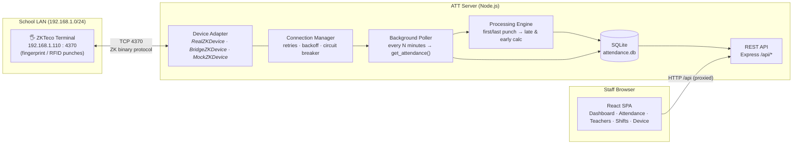
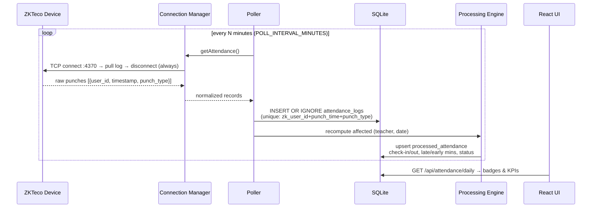
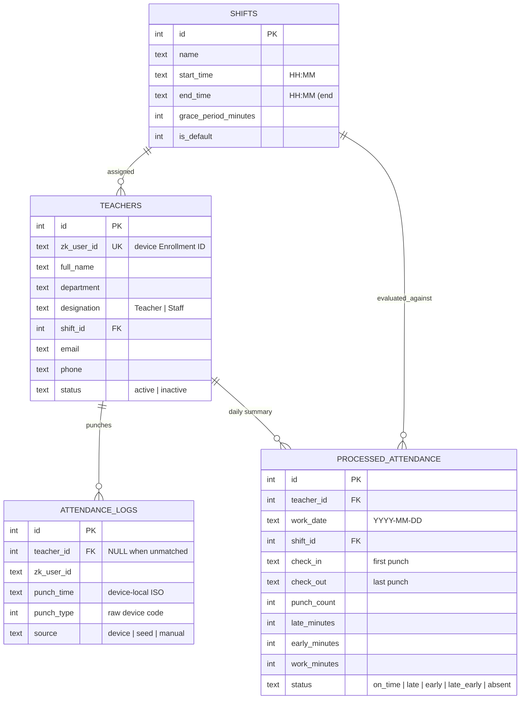

# ATT — Architecture Overview

## 1. System topology



The diagram shows **direct mode** (`ZK_MODE=real`) for a server on the school
LAN. For cloud hosting (`ZK_MODE=bridge`), the server replaces the direct
adapter with `BridgeZKDevice`; an authenticated school-side agent makes
outbound HTTPS requests to claim commands and execute them locally against the
terminal. The Render server never routes to a private device address.

## 2. Poll → Process → Present pipeline



## 3. Resilience model

| Concern | Mechanism | Where |
|---|---|---|
| Hung device / half-open socket | Hard timeout around every op | `zk/realDevice.js` → `withTimeout` |
| Device accepts few concurrent sessions | Connect → operate → **always disconnect** | `zk/realDevice.js` → `withConnection` |
| Transient network faults | Exponential backoff + jitter (3 attempts) | `zk/manager.js` → `call()` |
| Dead device hammering the network | Circuit breaker: opens after 5 consecutive failures, half-open probe after cool-down | `zk/manager.js` |
| Duplicate punches on re-poll | `UNIQUE(zk_user_id, punch_time, punch_type)` + `INSERT OR IGNORE` | `db/migrate.js`, `services/poller.js` |
| Unknown enrollment IDs punching | Stored with `teacher_id = NULL`, surfaced for import | `routes/device.js` → `/unknown-users` |
| Service downtime gaps | `ensureProcessed()` lazily back-fills missing days on view | `services/processor.js` |
| Shift edited after-the-fact | Last-30-days rebuild triggers automatically | `routes/shifts.js`, `routes/teachers.js` |

## 4. Data model (spec § 3)



## 5. Status algorithm (spec § C)

```
punches = sorted device punches for (teacher, date)
absent                if punches = ∅
checkIn  = first punch          checkOut = last punch (if ≥ 2 punches)
late     ⟺ checkIn  > start + grace        lateMinutes  = checkIn − start
early    ⟺ checkOut < end                  earlyMinutes = end    − checkOut
status = late_early | late | early | on_time
```

Tested in `server/test/attendanceLogic.test.js` (13 cases incl. overnight shifts,
stray mid-day punches, single-punch days, grace-boundary inclusivity).

## 6. Cloud hosting: authenticated LAN bridge

A Render/cloud service cannot open TCP connections to a terminal on a private
school IP. In `ZK_MODE=bridge`, the server queues a small allow-listed set of
operations (`testConnection`, `getUsers`, `getAttendance`, `setUser`) in
memory. `server/src/agent.js` makes outbound HTTPS polls using
`DEVICE_BRIDGE_TOKEN`, executes them through `RealZKDevice` on the school LAN,
and posts the result. The attendance poller then uses its normal idempotent
SQLite ingestion and processing path. The same bridge supports interactive
user import and enrollment push from the Device page.

The agent does not listen for inbound connections, persist attendance, or
expose TCP 4370. If the cloud process restarts, any in-flight command times out
and the existing poller retries at its next interval; attendance remains on
the terminal until a successful pull. Keep the server at one instance when
using its persistent SQLite disk.

This repository does **not** implement a ZKTeco ADMS receiver. The documented
K14 firmware does not provide ADMS push mode; cloud sync uses the LAN bridge.
Other device families can use ADMS only after a receiver is explicitly added
and tested for their firmware.

## 7. Project layout

```
ATT/
├── server/
│   ├── src/
│   │   ├── index.js                  boot: migrate→seed→manager→poller→API
│   │   ├── agent.js                  LAN-side HTTPS command agent for cloud mode
│   │   ├── config.js                 env-driven configuration
│   │   ├── db/{connection,migrate,seed}.js
│   │   ├── utils/attendanceLogic.js  ★ pure status algorithm
│   │   ├── zk/{deviceContract,realDevice,mockDevice,bridgeDevice,manager}.js
│   │   ├── services/{deviceBridge,poller,processor}.js
│   │   └── routes/{teachers,shifts,attendance,dashboard,device,bridge}.js
│   └── test/attendanceLogic.test.js
├── web/
│   └── src/{App.jsx, api/client.js, components/, pages/}
└── docs/ARCHITECTURE.md
```
