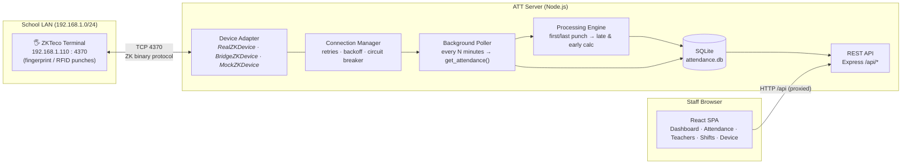
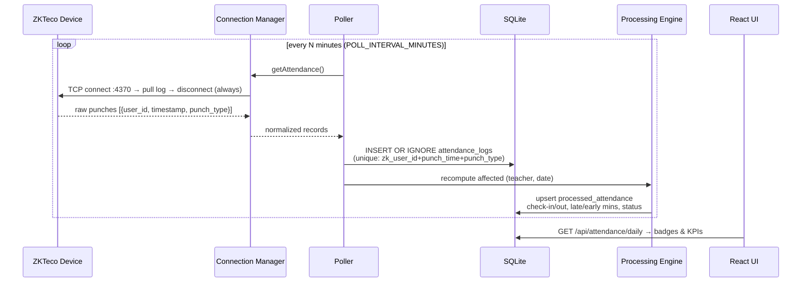
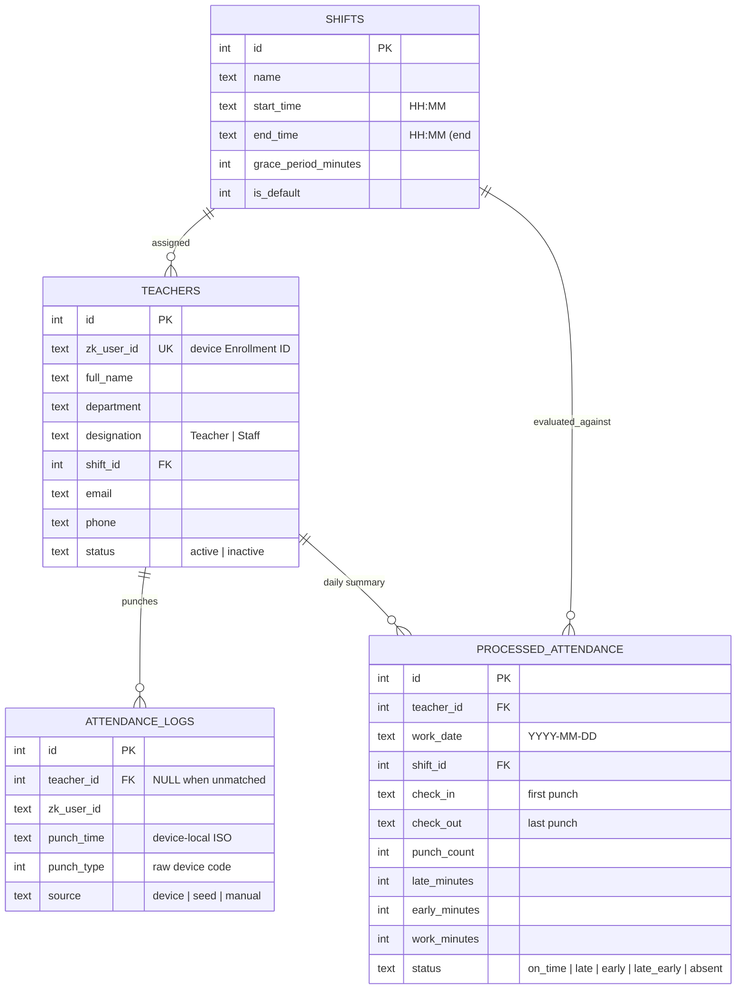

# ATT — Architecture Overview

## 1. System topology



The diagram shows **direct mode** (`ZK_MODE=real`) for a server on the school
LAN. For cloud hosting (`ZK_MODE=bridge`), the server replaces the direct
adapter with `BridgeZKDevice`; an authenticated school-side agent makes
outbound HTTPS requests to claim commands and execute them locally against the
terminal. The Render server never routes to a private device address.

## 2. Poll → Process → Present pipeline



## 3. Resilience model

| Concern | Mechanism | Where |
|---|---|---|
| Hung device / half-open socket | Hard timeout around every op | `zk/realDevice.js` → `withTimeout` |
| Device accepts few concurrent sessions | Connect → operate → **always disconnect** | `zk/realDevice.js` → `withConnection` |
| Transient network faults | Exponential backoff + jitter (3 attempts) | `zk/manager.js` → `call()` |
| Dead device hammering the network | Circuit breaker: opens after 5 consecutive failures, half-open probe after cool-down | `zk/manager.js` |
| Duplicate punches on re-poll | `UNIQUE(zk_user_id, punch_time, punch_type)` + `INSERT OR IGNORE` | `db/migrate.js`, `services/poller.js` |
| Unknown enrollment IDs punching | Stored with `teacher_id = NULL`, surfaced for import | `routes/device.js` → `/unknown-users` |
| Service downtime gaps | `ensureProcessed()` lazily back-fills missing days on view | `services/processor.js` |
| Shift edited after-the-fact | Last-30-days rebuild triggers automatically | `routes/shifts.js`, `routes/teachers.js` |
| Two ATT processes on one PC | `<ATT_HOME>/runtime.json` lock; second start exits 3, shell attaches | `services/instance.js` |
| Device moved / re-IP'd | Live reconfigure + LAN discovery from the Connect wizard | `zk/manager.js` · `net/diagnostics.js` |

## 4. Data model (spec § 3)

The attendance ledger remains keyed by Gregorian local dates for compatibility
with the ZKTeco terminal. BS conversion is applied in the web/report layer. The
school work calendar is persisted separately in `calendar_settings` (weekly
working weekdays) and `calendar_holidays` (one-off Gregorian dates or recurring
BS month/day definitions); non-working dates never generate absences.



## 5. Status algorithm (spec § C)

```
punches = sorted device punches for (teacher, date)
absent                if punches = ∅
checkIn  = first punch          checkOut = last punch (if ≥ 2 punches)
late     ⟺ checkIn  > start + grace        lateMinutes  = checkIn − start
early    ⟺ checkOut < end                  earlyMinutes = end    − checkOut
status = late_early | late | early | on_time
```

Tested in `server/test/attendanceLogic.test.js` (13 cases incl. overnight shifts,
stray mid-day punches, single-punch days, grace-boundary inclusivity).

## 6. Cloud hosting: authenticated LAN bridge

A Render/cloud service cannot open TCP connections to a terminal on a private
school IP. In `ZK_MODE=bridge`, the server queues a small allow-listed set of
operations (`testConnection`, `getUsers`, `getAttendance`, `setUser`) in
memory. `server/src/agent.js` makes outbound HTTPS polls using
`DEVICE_BRIDGE_TOKEN`, executes them through `RealZKDevice` on the school LAN,
and posts the result. The attendance poller then uses its normal idempotent
SQLite ingestion and processing path. The same bridge supports interactive
user import from the Device page; enrollment *push* appears only when the
`node-zklib` version on the agent machine provides a user-writing API (1.x does
not — the terminal keypad is the supported enrollment path, followed by
**Fetch device users → Import**).

The agent does not listen for inbound connections, persist attendance, or
expose TCP 4370. If the cloud process restarts, any in-flight command times out
and the existing poller retries at its next interval; attendance remains on
the terminal until a successful pull. Keep the server at one instance when
using its persistent SQLite disk.

This repository does **not** implement a ZKTeco ADMS receiver. The documented
K14 firmware does not provide ADMS push mode; cloud sync uses the LAN bridge.
Other device families can use ADMS only after a receiver is explicitly added
and tested for their firmware.

## 7. The installed Windows app (desktop layer)

```mermaid
flowchart TB
    subgraph PC["Windows 10/11 computer"]
        EXE["ATT Attendance.exe<br/><i>Electron shell</i><br/>window · tray · menus"]
        subgraph Backend["local backend (one instance, port from runtime.json)"]
            RT["bundled node.exe<br/>(official Node LTS)"] --> SRV["server.cjs<br/><i>whole backend in one file</i>"]
            SRV --> DB[("C:\\ProgramData\\ATT\\attendance.db")]
        end
        SVC["ATT Attendance Sync<br/><i>Windows service (WinSW)</i>"] -.same server.cjs.-> Backend
        EXE -- "spawn / attach" --> Backend
        EXE -- "load http://127.0.0.1:port" --> SRV
    end
    SRV -- "TCP 4370" --> ZK["🖐️ ZKTeco terminal"]
    LAN["other staff PCs<br/>http://&lt;this-pc&gt;:4000"] -- HTTP --> SRV
```

Design rules that keep a school PC trustworthy:

| Rule | Mechanism |
|---|---|
| One backend per computer | `<ATT_HOME>/runtime.json` instance lock; a second start exits with code 3 and the shell *attaches* to the running one (`server/src/services/instance.js`) |
| No Node on the target PC | the installer ships `resources\payload\runtime\node.exe`; every candidate runtime is **probed** for `node:sqlite` before use (`desktop/src/runtime.js`) |
| Service and app share one database | machine-wide `ATT_HOME = %ProgramData%\ATT`, ACL granted to Users by the installer |
| UI needs no staff password in-app | per-boot **loopback token** in `runtime.json`, honoured only for `127.0.0.1/::1` (`middleware/auth.js`) |
| The device link survives a re-point | `ZKManager.reconfigure()` swaps the adapter live; `config.applySettings()` mutates the shared config in place |
| The adapter survives library drift | `RealZKDevice` resolves every call through a `ZK_METHODS` alias map against the **installed** `node-zklib` (e.g. logs = `getAttendances`, never the non-existent singular) and raises an actionable error for methods that version lacks; `GET /api/device/status` reports `capabilities` so the UI disables enrollment push instead of failing after the click (`server/test/zkLibraryContract.test.js` locks this in) |
| Port conflicts never brick the app | packaged mode falls back to a free port and publishes the real URL in `runtime.json` |
| Crash resilience | shell restarts a dead backend with backoff; WinSW restarts the service; circuit breaker protects the terminal |

The React bundle is identical in browser and desktop: it feature-detects
`window.att` (exposed by `desktop/src/preload.js`) for tray/service/autostart
controls, and sends the loopback token automatically when present.

## 8. Project layout

```
ATT/
├── server/
│   ├── src/
│   │   ├── index.js                  CLI entry: boot · --service · --doctor · --agent
│   │   ├── bootstrap.js              bootServer(): migrate→seed→manager→listen→poller
│   │   ├── settings.js               persistent config.json store + ATT_HOME paths
│   │   ├── log.js                    rotating file log (service + installed app)
│   │   ├── config.js                 env > .env > config.json > defaults (mutable in place)
│   │   ├── agent.js                  LAN-side HTTPS command agent for cloud mode
│   │   ├── db/{connection,migrate,seed}.js
│   │   ├── net/diagnostics.js        subnet math · probes · LAN discovery · checklist
│   │   ├── services/{deviceBridge,poller,processor,instance,backup,winService}.js
│   │   ├── utils/attendanceLogic.js  ★ pure status algorithm
│   │   ├── zk/{deviceContract,realDevice,mockDevice,bridgeDevice,manager}.js
│   │   └── routes/{teachers,shifts,attendance,dashboard,device,bridge,system}.js
│   └── test/{attendanceLogic,deviceBridge,settings,diagnostics,systemRoutes}.test.js
├── desktop/                          Electron shell + Windows packaging
│   ├── src/{main,preload,tray,backend,runtime,paths,logger,service}.js
│   ├── build/{installer.nsh,icon.ico}   NSIS hooks: service page, ACLs, firewall, uninstall
│   ├── service/att-service.xml       WinSW service definition
│   ├── scripts/{make-assets,bundle-server,fetch-runtime,fetch-service-wrapper,prepare-payload}.mjs
│   └── electron-builder.yml
├── web/
│   └── src/{App.jsx, api/client.js, components/, pages/{…,Connect.jsx,Settings.jsx}}
├── .github/workflows/windows-installer.yml   payload smoke test + NSIS build + release
└── docs/{ARCHITECTURE,WINDOWS_APP,HARDWARE_SETUP,DEPLOYMENT,RENDER}.md
```
